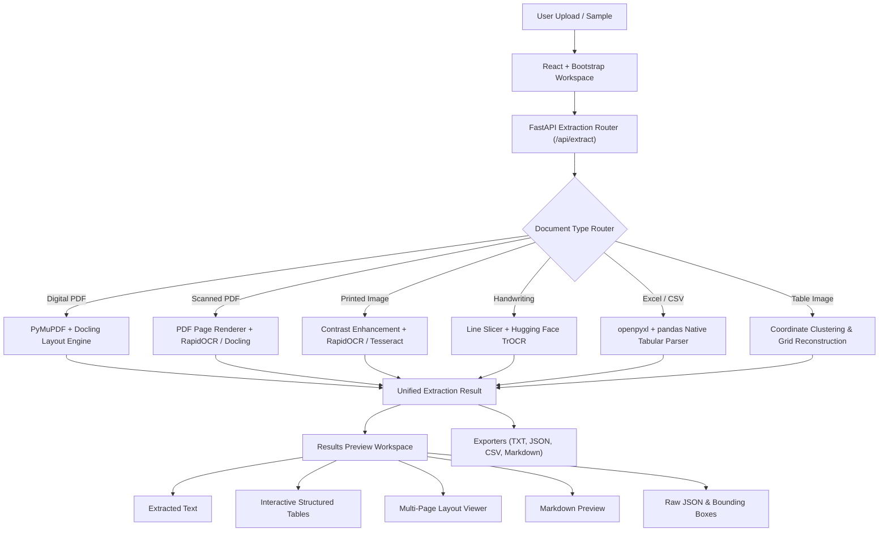

# OmniOCR — Intelligent Document Processing Platform
> **Extract. Understand. Export.**

OmniOCR is an enterprise-grade multi-format document extraction platform designed with a modern **React + Bootstrap** frontend and a high-performance **Python FastAPI** backend. It features an intelligent **Document Router** that dynamically dispatches documents to specialized neural engines (**Docling**, **RapidOCR**, **Tesseract**, **TrOCR**, **PyMuPDF**, and **pandas/openpyxl**) rather than forcing heterogeneous files through a generic OCR parser.

---

## Architecture Overview



---

## Key Features

1. **Intelligent Document-Type Router**:
   - `Automatic detection`: Inspects binary stream and MIME headers to select optimal pipeline.
   - `Scanned PDF`: High-DPI page rasterization + deep character recognition.
   - `Digital PDF`: High-speed vector text stream extraction with zero character degradation.
   - `Handwritten image`: TrOCR VisionEncoderDecoder model for cursive/script lines.
   - `Printed image`: Preprocessing and high-accuracy neural OCR.
   - `Excel / CSV`: Sheet, cell, column header, and tabular metrics extraction without OCR overhead.
   - `Photograph of a table`: OCR line coordinate clustering & grid boundary reconstruction.

2. **Multi-Engine Pipeline**:
   - **Docling**: Unified document parsing, deep layout analysis, and table reconstruction.
   - **RapidOCR**: State-of-the-art ONNX runtime neural character detection and text recognition.
   - **Tesseract OCR**: Classic OCR binary support with seamless automatic fallbacks.
   - **TrOCR (Hugging Face)**: Transformer-based handwriting recognition (`microsoft/trocr-small-handwritten`).
   - **PyMuPDF (`fitz`)**: Fast digital PDF parsing, vector text extraction, and native table detection.
   - **openpyxl + pandas**: Clean spreadsheet parsing across multiple sheets.

3. **Modern React Workspace UI**:
   - Radiant dark glassmorphism design system (`Inter` & `JetBrains Mono` fonts).
   - Drag-and-drop file upload with live file preview and size validation.
   - One-click **Pre-loaded Sample Test Drive** bar (6 ready-to-test documents).
   - Interactive table grids with sticky headers, search, and CSV clipboard copy.
   - Multi-format exporter (`TXT`, `JSON`, `CSV`, `Markdown`).
   - Session history to switch between recent extractions.

---

## Directory Structure

```
IntelligentDocumentProcessing/
├── frontend/                     # React + Vite + Bootstrap application
│   ├── src/
│   │   ├── components/
│   │   │   ├── Header.jsx               # Navigation bar & system status
│   │   │   ├── FileUploader.jsx         # Drag-and-drop file upload
│   │   │   ├── DocumentTypeSelector.jsx # Document type & engine selectors
│   │   │   ├── SampleSelector.jsx       # One-click test drive buttons
│   │   │   ├── ResultsViewer.jsx        # Multi-tab results & table preview
│   │   │   └── ExportButtons.jsx        # Single-click download buttons
│   │   ├── services/
│   │   │   └── api.js                   # API client for backend
│   │   ├── App.jsx                      # Main workspace controller
│   │   ├── index.css                    # Glassmorphism design system
│   │   └── main.jsx
│   ├── package.json
│   └── vite.config.js                   # Proxy configuration for /api
├── backend/                      # Python FastAPI application
│   ├── app/
│   │   ├── main.py                      # FastAPI app entry point & CORS
│   │   ├── routes/
│   │   │   └── extraction.py            # /api/extract, /api/export, /api/samples
│   │   ├── services/
│   │   │   ├── document_router.py       # Core router & type validation
│   │   │   ├── pdf_service.py           # Digital & scanned PDF engines
│   │   │   ├── image_service.py         # Image OCR & table reconstruction
│   │   │   ├── handwriting_service.py   # TrOCR handwriting pipeline
│   │   │   └── spreadsheet_service.py   # Excel & CSV tabular parser
│   │   └── utils/
│   │       └── exporters.py             # TXT, JSON, CSV, Markdown generators
│   └── requirements.txt
├── samples/                      # Built-in sample test documents
│   ├── quarterly_financial_report.xlsx
│   ├── regional_sales_records.csv
│   ├── scanned_medical_invoice.png
│   ├── docling_tech_specification.pdf
│   ├── handwritten_prescription_notes.png
│   └── table_matrix_photo.png
├── README.md
└── .gitignore
```

---

## Quickstart Guide

### 1. Backend Setup (FastAPI)

```bash
cd backend
python -m pip install -r requirements.txt
python -m uvicorn app.main:app --host 127.0.0.1 --port 8000 --reload
```
- API Docs: `http://127.0.0.1:8000/docs`
- Health Check: `http://127.0.0.1:8000/health`

### 2. Frontend Setup (React + Vite)

```bash
cd frontend
npm install
npm run dev
```
- Open your browser at: `http://127.0.0.1:5173`

---

## API Endpoints

| Method | Endpoint | Description |
| :--- | :--- | :--- |
| `GET` | `/api/document-types` | List supported document types and validation rules |
| `GET` | `/api/engines` | Query active engine capabilities (Docling, RapidOCR, Tesseract, TrOCR) |
| `POST` | `/api/extract` | Multipart upload for file extraction with `document_type` and `engine` |
| `POST` | `/api/export` | Download extraction result in TXT, JSON, CSV, or Markdown |
| `GET` | `/api/samples` | List preloaded demonstration documents |
| `POST` | `/api/extract-sample/{id}` | Execute extraction pipeline on a preloaded sample |

---

## Phased Roadmap Progress

- [x] **Phase 1: UI and Multi-Engine OCR Foundations** (React + Bootstrap + FastAPI + RapidOCR / Tesseract)
- [x] **Phase 2: Multiple Format Routing** (Scanned & Digital PDFs, Excel, CSV, Docling layout analysis)
- [x] **Phase 3: Advanced Recognition & Handwriting** (TrOCR integration, image contrast preprocessors, confidence metrics)
- [x] **Phase 4: Complete Application & Exporters** (TXT, JSON, CSV, Markdown downloads, session history, preloaded sample test drive)
